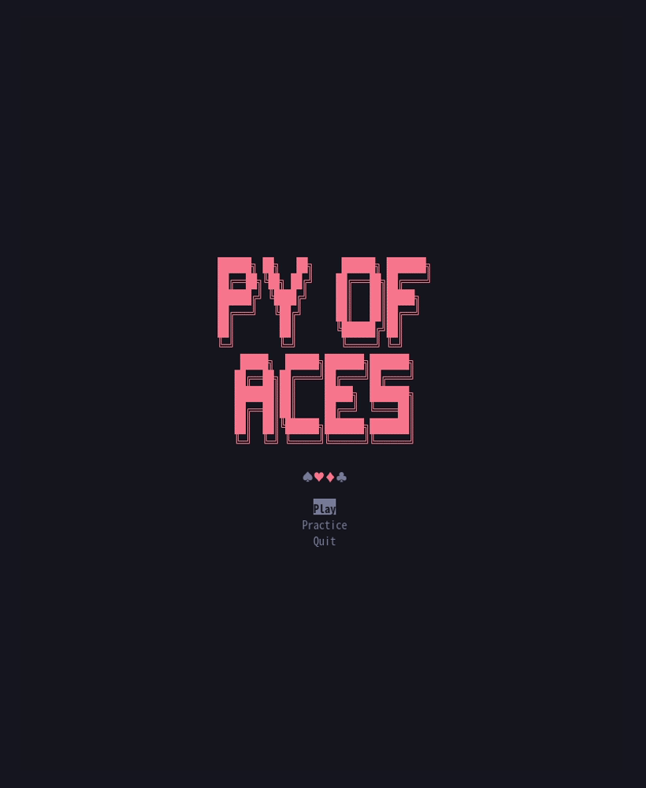

<div align="center">
<pre>
. ██████╗ ██╗   ██╗     ██████╗ ███████╗.
. ██╔══██╗╚██╗ ██╔╝    ██╔═══██╗██╔════╝.
. ██████╔╝ ╚████╔╝     ██║   ██║█████╗  .
. ██╔═══╝   ╚██╔╝      ██║   ██║██╔══╝  .
. ██║        ██║       ╚██████╔╝██║     .
. ╚═╝        ╚═╝        ╚═════╝ ╚═╝     .
.     █████╗  ██████╗███████╗███████╗   .
.    ██╔══██╗██╔════╝██╔════╝██╔════╝   .
.    ███████║██║     █████╗  ███████╗   .
.    ██╔══██║██║     ██╔══╝  ╚════██║   .
.    ██║  ██║╚██████╗███████╗███████║   .
.    ╚═╝  ╚═╝ ╚═════╝╚══════╝╚══════╝   .
</pre>
</div>

A terminal-based Blackjack game written in Python using [blessed](https://pypi.org/project/blessed/).



## Features

### Game Modes

- **Normal Mode**: Traditional blackjack with money management ($1,000 starting money)
- **Practice Mode**: Unlimited play without losing money, tracks total winnings/losses

### Complete Blackjack Features

- **Hit, Stand, Double Down**: All standard blackjack actions
- **Split Hands**: Split pairs and play multiple hands simultaneously
- **Blackjack Detection**: Automatic detection and proper payouts (2.5x for blackjack)
- **Dealer AI**: Dealer hits on soft 17, follows standard casino rules
- **Ace Handling**: Smart ace value calculation (1 or 11)

## Installation

### Prerequisites

- Python 3.13+
- Terminal with Unicode support

### From PyPI

```bash
uv tool install py-of-aces
# or
pipx install py-of-aces
```

### Arch Linux

The `PKGBUILD` in this repo builds the latest release:

```bash
makepkg -si
```

### From source

```bash
git clone https://github.com/vinegm/Py-of-Aces.git
cd Py-of-Aces
uv tool install .
```

## Usage

```bash
pyaces
```

`pyofaces` and `poa` start it too. Command line flags:

- `--version`: print the version and exit
- `--config <path>`: load the config from `<path>` instead of the default location
- `--no-config`: ignore the config file and run with the built-in defaults
- `--seed <seed>`: shuffle the same way every run, as the demo does

## Configuration

Py of Aces reads `$XDG_CONFIG_HOME/pyaces/config.toml` (`~/.config/pyaces/config.toml` when `XDG_CONFIG_HOME` is unset). The file is optional: anything it leaves out keeps its built-in default (see `py_of_aces/config.py`), a file that can't be read or parsed falls back to the defaults entirely, and an invalid setting falls back to its own default. Problems are printed as warnings when the game exits. An example config with every setting is provided at `example-config.toml`.

## Development

Needs [uv](https://docs.astral.sh/uv/). `make install` sets up the environment, `make run` starts the game, and `make ci` runs what CI runs: `ruff format --check`, `ruff check` and `pyright`. `make fmt` formats the code. `make demo` records `assets/demo.gif` from `vhs/demo.tape` with [VHS](https://github.com/charmbracelet/vhs), on a seeded deal so it plays the same every time.

## Game Rules

### Blackjack Basics

- **Goal**: Get your hand value as close to 21 as possible without going over
- **Card Values**:
  - Number cards (2-10): Face value
  - Face cards (J, Q, K): 10 points
  - Aces: 1 or 11 (automatically optimized)

### Winning Conditions

- **Blackjack**: 21 with first two cards (pays 2.5x)
- **Player Win**: Higher value than dealer without busting (pays 2x)
- **Dealer Bust**: Dealer goes over 21, player wins (pays 2x)
- **Push**: Same value as dealer (bet returned)

### Special Actions

- **Double Down**: Double your bet, receive exactly one more card
- **Split**: Split matching cards into two separate hands (requires additional bet)

## License

This project is licensed under the MIT License - see the [LICENSE](LICENSE) file for details.
